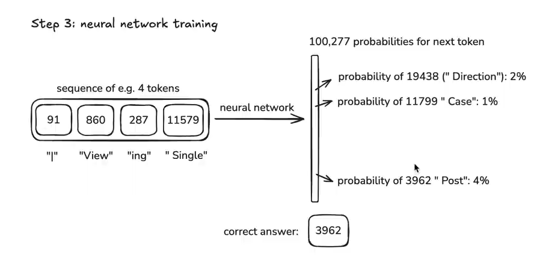

# LLM 原理
> https://www.bilibili.com/video/BV16cNEeXEer/?spm_id_from=333.337.search-card.all.click&vd_source=5647117003b4561537f7f34549fe7ecc
> https://huggingface.co/spaces/HuggingFaceFW/blogpost-fineweb-v1
> 本章从 从本质开始将其再到 工作/原理/训练过程 最后到 能力边界 来展开讲解

从数学角度来讲 AI 就是一个 **高阶拆测机(Guessing Machine)/概率预测引擎** 你通过输入 一个 `question` AI 通过 `F(question)` 来计算问题的解 最后输出一个回答给你


## 参数
参数就是存储知识的容器, 每个参数 表示 编码语言的规律, 现实世界的 现象/知识/情绪/语境/多义词/指代消除/隐含语言 LLM 都会通过 参数来存储表达

为何需要那么多参数呢? 因为复杂程度高, 比如 一词多义 不同 字/词 在不同 语境下 表达的意思不同 人类可以理解 不代表 LLM 可以理解 所以 LLM 就需要 将其编码为参数来得知这种差异, 指代消解 用人称代词来判断 这个是什么 但是对于 LLM 也不知道该怎么推理 这也需要编码为 参数 后进行存储理解

这些都是只 表面复杂的知识, 若是包含我们国家5000年历史那么使用的参数量远远不会那么小

## 训练 混沌到有序
1. 初始
训练开始时所有参数都是 随机小数,通常在 `-0.1~0.1` 但是刚开始对于 LLM 是没有意义的, 需要统一一遍遍重复的训练 来让模型知道各个参数的意义
2. 训练之初
加入第一次训练让 LLM 知道 "今天天气" 这四个字意思后 LLM 会预测下一个词是什么? 假如有一堆词 (这个->10%, 你说->1%, 我说->8%,不错->2%) 那么 LLM 会倾向于选择 "这个" 作为预测的下一个词语, 在初始状态下参数是随机的所以 推测的词也是混乱的
3. 错误意识
接下来我们告诉 LLM 这是错误的, 让 LLM 意识到自己的错误 再将准确答案告诉 LLM 以此降低 错误答案 "这个" 的概率, **这里我们用 损失(Loss) 衡量错误大小**
- Loss 一句话概括就是 预测值和正确值之间的距离, 差距越大 Loss 越大, 训练的目的就是为了降低 Loss, 最终趋近于0, 同样的这个训练方式可以迁移到 智能体训练
4. 模型改进
模型分析我预测错误是哪些参数设置不对 然后调整这些参数, 通过该调整方式进行微调让概率变化
**模型如何减小或增加呢?**
```
# 调整前
参数1=0.12345
参数2=-0.56789
# 调整后
参数1=0.12345 + 0.0001
参数2=-0.56789 - 0.0001
```
5. 重复迭代训练
以上过程不断重复错误不断出现参数不断微调慢慢的,混乱的参数变为有意义的知识

6. 总结就是 一开始参数是无意义的, 每次训练都会告诉其正确性 不正确则让模型 意识到自己错误原因并且微调 Loss, 千百次的迭代将一切都是无意义的参数转变为有意义的参数

### 反向传播与梯度下降与学习率


## 预训练阶段
> https://tiktokenizer.vercel.app/
> https://huggingface.co/spaces/HuggingFaceFW/blogpost-fineweb-v1
> https://www.bilibili.com/video/BV16cNEeXEer/?spm_id_from=333.337.search-card.all.click&vd_source=5647117003b4561537f7f34549fe7ecc

下载和处理互联网数据, 所有 LLM 提供商 都有类似的内部数据集, 我们主要是从互联网获取大量文本可公开数据
- 首先进行 URL 过滤 将域名黑名单去除
  - 文本提取(过滤 HTML/CSS 等)
  - 语言过滤(决定模型 在那种语言表现好一点 若纯英语模型则过滤其他语言)
- 分词(将原始文本转换为 字节过程称为分词)
```
# 稍微变化 词语结构 分词出来的 词元 结果是完全不同的
hello world
15339, 1917


helloworld
71, 96392
```
- 训练神经网络
  - 我们可以自定义处理词元窗口大小(长窗口非常消耗计算资源)
  - 刚开始我们抽样去除小部分词元后形成上下文 用于 推测下一个词应该是什么(若是错误则 告诉模型 让其更新出现概率)
    - 
  - 