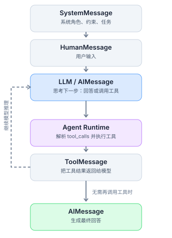
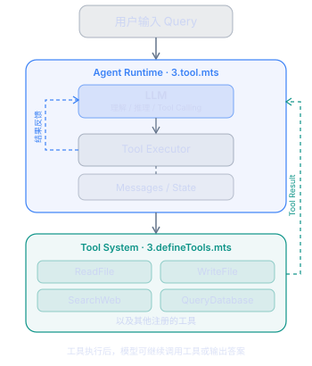
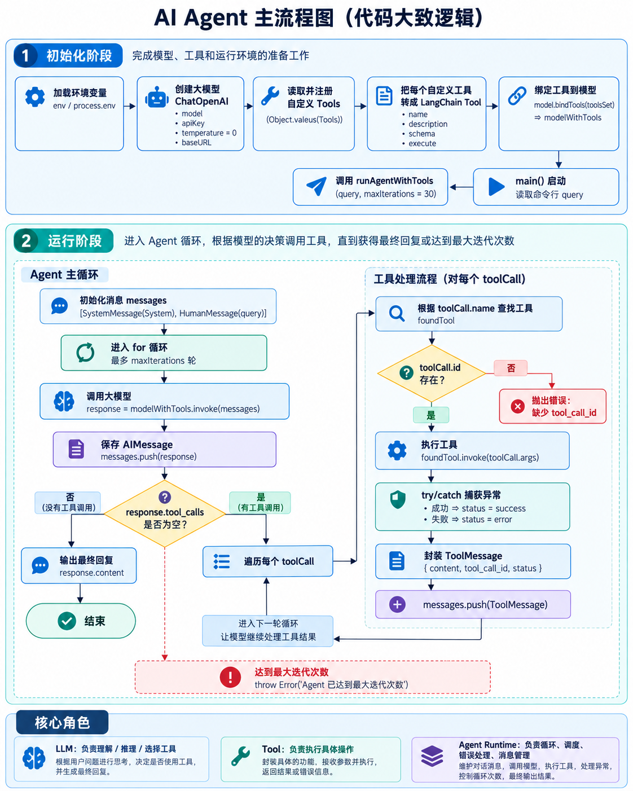
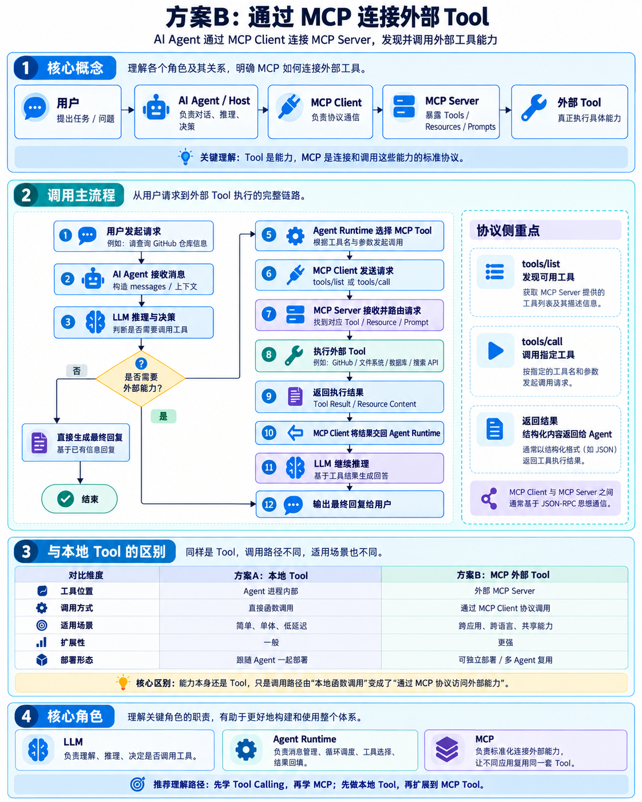
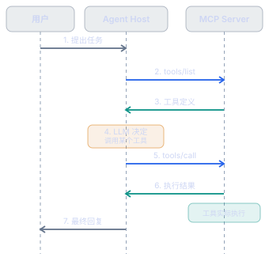

# Tool & MCP

## Tool
我们在使用 Agent 时 读/写 文件/目录 与 执行命令 都是交给我们的 Tool
Tool 的作用就是 **给大模型扩充能力边界, 让大模型通过外部程序获取信息执行操作从而影响外部环境**
LLM 决策需要用哪个 Tool, Tool 主要就是 执行, 所以我们在定义工具时需要 标注 工具的作用
```js
// 这些都是基础且常用的能力
read_file 读取文件
write_file 写入问及那
list_directory 文件夹列表
execute_command 执行命令
call_api 调用外部 API
```


## 消息类型
### SystemMessage(系统指令)
1. 作用: 设定 AI 角色, 可以干什么, 能力, 回答哪些问题, 行为和规范
### HumanMessage(用户指令)
1. 作用: 用户问题
### AIMessage(模型消息)
1. 作用: AI 回复的信息
### ToolMessage(工具结果消息)
1. 作用: 工具调用返回结果




我们接下来就来实现一个 简单的 工具调用 + Agent 流程
首先是 工具定义, 我们这里实现一些常用工具和API调用, 还有 **定义工具/工具注册/配置参数和执行逻辑** 方法我们统一到 `defineTool` 中
[工具定义](../../code/AIAgent/aiagent/1.tool/3.defineTools.mts)

从 **创建模型/绑定工具/执行循环/处理消息** 让模型调用工具直到回复完毕
[Agent Loop](../../code/AIAgent/aiagent/1.tool/3.tool.mts)

整体编码流程图




-----------

## MCP(Model Context Protocol) 模型上下文协议
> https://www.anthropic.com/news/model-context-protocol
> https://academy.claude.com/courses/building-with-the-claude-api/introducing-mcp
> https://academy.claude.com/zh-CN/courses
> https://academy.claude.com/zh-CN/all
> JSON-RPC: https://www.jsonrpc.org/specification
> https://modelcontextprotocol.io/specification/2026-07-28/basic/authorization/index

1. 本质: 解决模型跨语言/AIApp 调用 的一套 通信标准协议
我们系统将我们上面实现的 Tool 提供给 Claude/Cursor/Codex/自己的Agent 或 不同语言开发 AIApp 上使用 我们即可考虑 MCP

我们上面开发的 Tool 属于本地集成方案, AIAgent 直接调用你本地的 Tool 来扩展能力 对于你的 Agent项目来说是没有问题但是未来若是出现 你的 工具可能需要给 Idea Plugin 使用 亦或者 GoAgent 也需要使用 甚至 多团队需要接入这些工具 这时候 本地 Tool 就显得无能为力

MCP 连接外部 Tool 方案, MCP 只是增加了 增加 Tool 发现/连接/调用 的方式, 其余还是不变


2. MCP 调用方式:
   1. 可以本地进程之间 stdio 通信
   2. Streamable HTTP 远程连接服务

3. MCP 整体架构, 分为三个角色
   1. Host(宿主): 我们自己开发的 AIAgent 应用
   2. MCPClient(协议客户端): 位于 Host 内部, 负责 MCPServer 通信
   3. MCPServer(协议服务器): 暴露工具, 资源提示模板并处理对应请求


4. 实现一个 MCP 调用
```shell
pnpm add @modelcontextprotocol/server @modelcontextprotocol/client zod
```
MCP Server 我们通过 `serveStdio` 定义 该 MCP 是通过 Stdio 进行通信, 通过 `registerTool` 来注册 tool
[](../../code/AIAgent/aiagent/2.mcp/mcp-server.mts)

MCP Client 位于我们AIAgent应用内部用 `StdioClientTransport` 来通过 Stdio 进行连接进程间 MCPServer, 连接成功后即可查看可用工具列表, 最后通过 LLM 选用 工具调用即可
[](../../code/AIAgent/aiagent/2.mcp/mcp-client.mts)

5. MCP 协议: 底层协议通过 JSON-RPC 2.0 表达请求与响应
[JSON-RPC 2.0](https://blog.modelcontextprotocol.io/posts/2026-07-28/?utm_source=chatgpt.com)

6. 那么我们如何将 之前写的 Tool MCP 呢
这里是实现的基础框架你可以尝试自己实现一下
```ts
import { MCPAdapter } from '@langchain/mcp-adapters'

const adapter = new MCPAdapter({
  servers: {
    docs: {
      url: 'https://docs.langchain.com/mcp',
    },
  },
})

try {
  // 获取 MCP 工具并转换为 LangChain Tool
  const mcpTools = await adapter.listTools()
  console.log(mcpTools);
  const allTools = [...toolsSet, ...mcpTools]

  // 绑定
  const modelWithTools = model.bindTools(allTools)

  // 后续仍使用你原来的 Agent Loop
  // Agent Loop
  
} finally {
  await adapter.close()
}
```
实现完整版本也提供出来供你参考


## 总结一下
Tool 是为 LLM 扩展能力边界, MCP 是发现/连接/调用 Tools 标准协议, Agent 是工具使用的决策者
Agent = LLM + Runtime + Tools