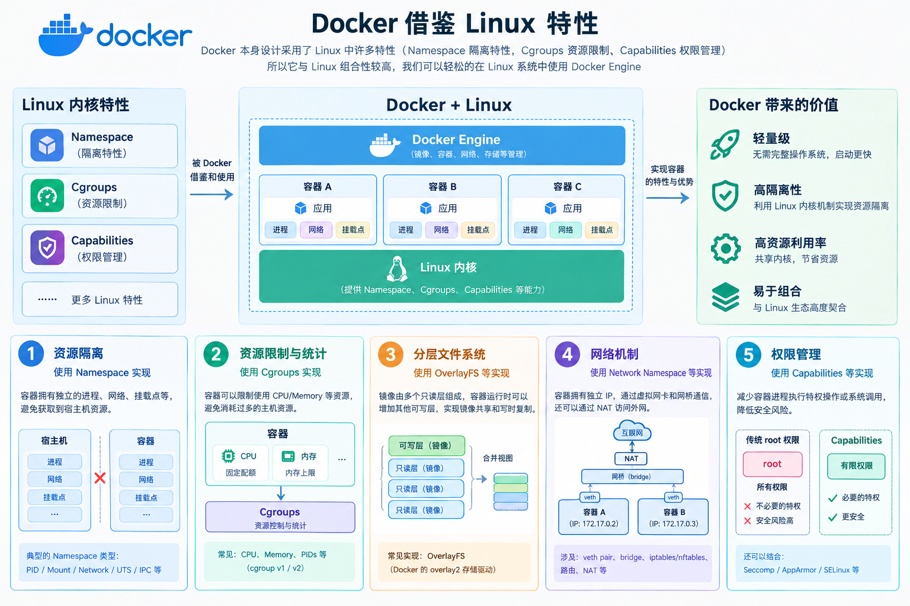

# Docker

Docker 本身设计采用了 Linux 中许多特性(Namespace隔离特性, Cgroups资源限制, Capabilities权限管理) 所以它与 Linux 组合性较高, 我们可以轻松的在 Linux 系统中使用 Docker Engine
- 资源隔离: 容器荣有独立进程, 网络, 挂载点等 避免可以获取到宿主机资源
- 资源限制与统计: 容器可以限制的使用 CPU/Memory 等资源 避免容器消耗过多的 主机资源
- 分层文件系统: 镜像由多个只读层组成, 容器运行时可以增加其他可写层, 实现镜像共享和写时复制
- 网络机制: 容器拥有独立 IP, 通过虚拟网卡和网桥通信, 还可以通过 NAT 访问外网
- 权限管理: 减少容器进程执行特权操作或系统调用

## Docker Engine
1. Docker Engine 分为两个系列
- 社区版(CE Community Edition) 主要提供 容器管理 基础功能 针对小团队开发与实验, 免费使用
- 企业版(EE Enterprise Edition) 在社区版基础上增加 容器管理,镜像管理,插件,安全等额外功能 为了让容器更加稳定的运行和管理, 但是需要收费

2. Docker Engine 依赖环境
- Linux
- Window
- Mac

## Docker 特性
### 虚拟化(Virtualization)特性
虚拟化简单来说 就是 将一份物理资源转换为若干逻辑独立可管理的资源, 这里提到的物理资源就是 CPU 运算资源, 存储资源, 以及网络传输资源

1. 跨平台技术
虚拟化技术不仅可以提高资源利用率还可以通过对底层的抽象 为上层提供相对统一运行环境, 从而降低平台对特定硬件资源依赖

计算机发展早期 不同平台 硬件资源,架构,指令集 都有些许差异程序需要对不同平台进行兼容性适配 这会大大降低 开发人员的精力并增加开发成本提升程序维护复杂度

为了解决该问题 通过在上层程序和底层硬件中间引入一个抽象层, 为其提供一个面向上层程序的统一 接口

2. 提高资源使用率