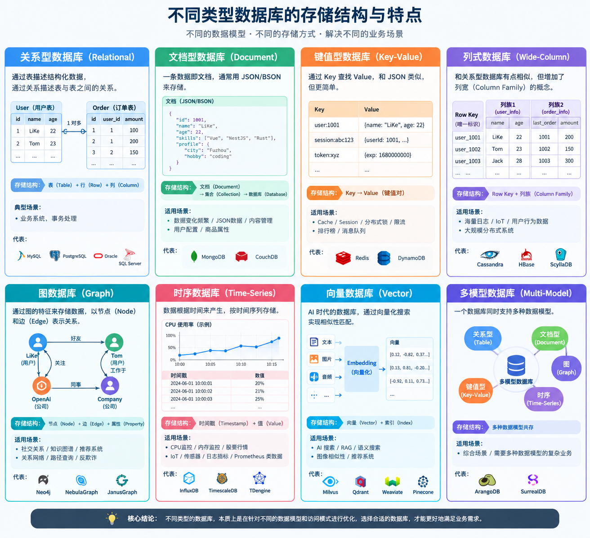

# DB 通识
> 学会MySQL基本操作与原理
> InnoDB: https://github.com/jeremycole/innodb_ruby


## SQL(Structured Query Language) 语言/是什么?
1. 定义:
SQL 是用于关系型数据库管理系统交互标准语言 可以用于定义,查询,创建管理数据库中数据以及对象
我这边举几个例子就会明白
- Shell与内核: 这里的关系就像 Shell 脚本和 内核的关系 通过 Shell 命令或脚本 来让内核调度任务
- 语言与操作系统: 通过 Node/Java/Python/C++/Rust... 你可以对系统进行 创建/删除/管理 等操作
简单来说 就是 SQL 就是用于 管理数据库系统的语言
2. 作用:
- 数字化 + AI 时代最重要的就是 数据筛选/分析, 在这个时代人们都想要找到一个 确定性的技术 但是最确定的技术永远是 融入到自身的 基础素养/眼界同时最确定的事情 就是变化
SQL 他就是结构化英语查询语言 上手极为简单 它的语法和关键字比较编程语言可以说是 及其简洁
3. 分类
- DDL(Data Definition Language): 数据定义语言, 定义与操作数据库对象,数据库,表,列
- DML(Data Manipulation Language): 数据操作语言, 操作数据表相关记录
- DCL(Data Control Language): 数据控制语言, 定义访问权限和安全级别
- DQL(Data Query Language): 数据查询语言, 数据分析筛选
4. DBMS/DBS/DB 区别
- DBMS(Database Mananger System) 是管理多个数据库的工具 所以它是 多个DB + 管理
- DB(Database) 你可以理解为数据表
- DBS(Database System) 它可以包含数据库 + 数据库管理系统 + 数据库管理人员
- 那么我们所熟知的 MySQL,ProgresSQL,Oracle 都属于 DBMS, 我们可以通过 [DBEngine](https://db-engines.com/en/ranking) 来查看 DB 使用排名

5. 数据表概念模型:
- 实体: 表中的一条数据, 你可以理解为一个人
- 属性: 表中一条数据的某一项, 理解为 一个人的身上的属性如(姓名,年龄,身高等等 用于获取人类信息的东西)
- 关系: 一对一/一对多/多对一/多对多, 理解为 一对一你理解为 一个人拥有 一个 身份证, 一对多 理解为 一个人可以有多个职位, 多对一 理解为 同一职位可以有多个人, 多对多理解为 一个学生可以选多个课程, 多个课程可供一个学生选择

6. 规范: 
- 表名/别名/字段/字段 为 小写
- SQL 保留字, 函数名, 绑定变量 为 大写

7. 数据库分类
根据不同场景我们将采用不同类型的数据库

关系型数据库主要特征就是通过表描述结构化数据通过关系描述表与表之间的关系

文档型 一条数据即文档, 通常用 JSON/BSON 来存储 适合 数据变化频繁/JSON数据/内容管理/用户配置/商品属性

KeyValue 型 通过 Key 查找 Value 和 JSON 相同 适合 Cache/Session/分布式锁/限流/排行榜/消息队列

列数据库 和 关系型数据库有点相像 但是增加 列宽概念 适合 海量日志/IoT/用户行为数据/大规模分布式系统

图数据库 通过 图的特征来存储数据 适合 社交关系/知识图谱/推荐系统/关系网络/路径查询/反欺诈

时序数据库 数据根据时间来产生 适合 CPU监控/内存监控/股票行情/IoT/传感器/日志指标/Prometheus 类指标数据

向量数据库 AI时代数据库 通过向量化搜索

多模型数据库 一个数据库同时支持多种数据模型 综合场景

- 关系型: MySQL, PostgreSQL, Oracle, SQLServer

- NoSQL:
  - 文档型: MongoDB
  - 键值型: Redis
  - 列型: HBase
  - 图数据库: Neo4j
  - 时序数据库: InfluxDB
  - 向量数据库: Milvus, Qdrant, Weaviate, Pinecone
  - 多模型数据库: ArangoDB, SurrealDB




----

## 数据库基本操作
数据库创建流程: 创建数据库 -> 创建数据表 -> 确定字段 -> 插入数据
<br>


每个流程都是下个流程的载体 没有载体也就无法存储数据 那么我们也没法 分析查询数据, 数据库通过 划分多个层次来控制颗粒度

MySQL 内置了 一些数据库 如 `sys/information_schema/performance_schema/mysql` 等数据库这些分别是 用于 记录 MySQL 服务器状态与性能状态还有 MySQL 的信息数据库

MYSQL 是以分号结尾的没有分号 MYSQL 认为改语句还没有编写完成会提示错误

1. 数据库 创建/查看
```sql
-- 创建一个数据库
CREATE DATABASE <DATABASE_NAME>;

-- 查看所有数据库
SHOW DATABASES;
```

2. 数据表 以及常规操作
```sql
-- 创建表
CREATE TABLE <DATABASE_NAME.TABLE> (
  <field> <type> <CONSTRAINT>
);

-- 查看表结构
DESCRIBE <DATABASE_NAME.TABLE>;

-- 查看当前数据库表
USE <DATABASE_NAME>;
SHOW TABLES;

-- 主键设置(主键特性: 非空且不能重复, 唯一性, 提高查询效率)
ALTER TABLE <DATABASE_NAME.TABLE> ADD COLUMN <field> <type> PRIMARY KEY AUTO_INCREMENT;
```

3. 插入数据
```sql
INSERT INTO <DATABASE_NAME.TABLE> ([<field>...]) VALUES ([<value>...])
```
### DDL(Data Definition Language)
我们最常用的就是 `CREATE`, `DROP`, `ALTER`, 但是实际上我们较少编写 DDL 因为我们会使用 可视化工具 来帮助我们创建 数据库和数据表 如 (MySQL, Oracle, MariaDB, PostgresSQL, Navicat, HeidiSQL)
1. 对数据库进行定义
```sql
-- 创建和删除表
CREATE DATABASE user;
DROP DATABASE user;
```
2. 数据表定义
```sql
CREATE TABLE [table_name] (
  field_name data_type [constraint]
);

-- example user
CREATE TABLE `user` (
  --       int 最长为 11 位,不能为空, 自增长id
  `user_id` int(11) NOT NULL AUTO_INCREMENT,
  `name` VARCHAR(255) NOT NULL
);
```
3. 实现一个 用户表
- 字段为 用户名, 密码, 邮箱, 手机号, 昵称, 头像, 个人介绍, 创建时间, 修改时间
- 一般在创建表前会先删除表, 防止上次创建的表还存在
后面我们会介绍不同索引的作用, 现在只须要知道有三种类型索引
```sql
-- 先删除表在创建
DROP TABLE IF EXISTS `user`;
CREATE TABLE `user` (
  -- 设置 id 为无符号大整数类型, 自增且设为主键
  `id` BIGINT UNSIGNED AUTO_INCREMENT PRIMARY KEY,
  `username` VARCHAR(50) NOT NULL,
  `password_hash` VARCHAR(255) NOT NULL,
  `email` VARCHAR(254) NOT NULL,
  `nickname` VARCHAR(50),
  `avatar_url` VARCHAR(512),
  `phone` VARCHAR(20),
  `status` VARCHAR(20) NOT NULL DEFAULT 'active',
  `email_verified_at` DATETIME NULL,
  `last_login_at` DATETIME NULL,
  -- 创建 id 为唯一索引, 为了更快检索, 指定索引类型为 B+Tree
  -- UNIQUE INDEX 唯一索引
  -- HASH INDEX 哈希索引
  -- NORMAL INDEX 普通索引
  UNIQUE INDEX `id` (`id`) USING BTREE
  -- 指定存储引擎为 InnoDB, 字符集为 UTF8, 字符排序比较规则为 utf8_general_ci, 指定 InnoDB 行存储格式
) ENGINE = InnoDB CHARACTER SET = utf8 COLLATE = utf8_general_ci ROW_FORMAT = Dynamic;
```

4. 修改表结构
```sql
-- 增加列
ALTER TABLE `user` ADD (age int(10));

-- 修改列名
ALTER TABLE `user` RENAME COLUMN age TO user_age;

-- 修改列数据类型
ALTER TABLE `user` MODIFY (user_age float(3, 1));

-- 删除列
ALTER TABLE `user` DROP COLUMN user_age;
```

5. 数据表常见约束
- 主键约束: 保证唯一标识(UNIQUE + NOT NULL)
- 外键约束: 保证表与表之间完整性 一个表外键对应另一个表主键
- 唯一性约束: 保证该字段数据在该表中只存在一次
- 默认约束: 默认值设置
- 范围约束: 检查字段值是否在有效范围内

## 设计数据表原则
1. 数据表个数越少越好(证明实习和联系设计简洁)
2. 数据表字段个数越少越好
3. 数据表联合主键个数越少越好
4. 使用主键和外键越多越好

## SQL 是如何执行的呢?
不同的数据库执行 SQL 流程 是不同的, 但是原理基本相同

这里提到相同的是: 语法检查/解析 -> 语义检查 -> 权限检查(不同数据库时机不同) -> 查询优化(需要优化 SQL 时存在) -> 执行