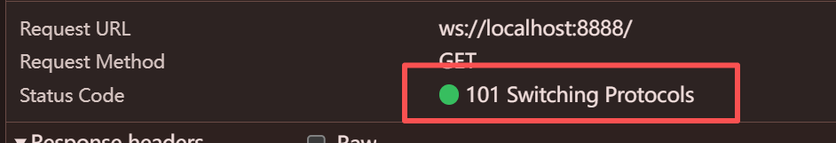
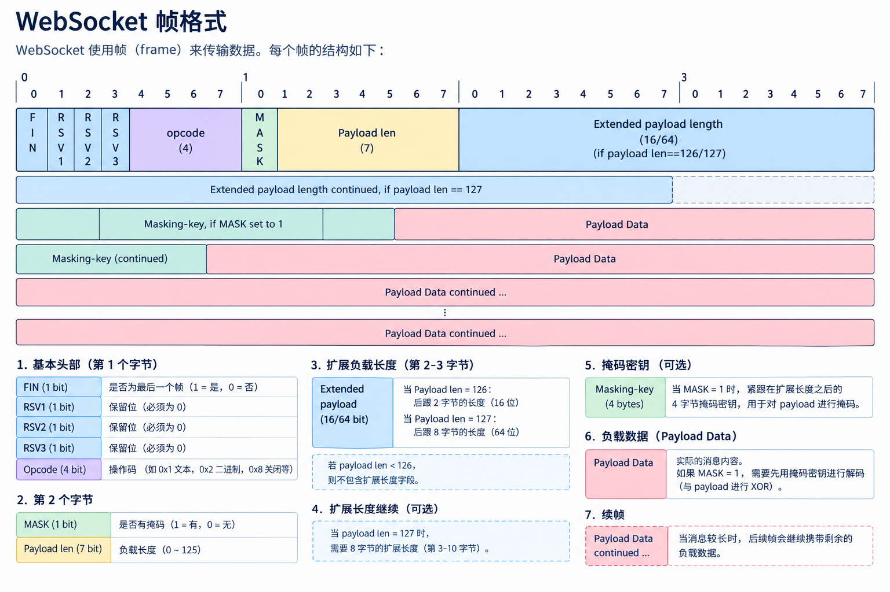

# Websocket/ws

> [https://developer.mozilla.org/en-US/docs/Web/API/WebSockets_API](https://developer.mozilla.org/en-US/docs/Web/API/WebSockets_API)

## HTTP 架构模式

1. 特点

- 半双工协议: 数据在同一时刻只能单向流动
- 服务器不能主动推送数据给浏览器

## 双向通信

1. Comet 用于 Web 推送技术, 能使服务器实时将数据推送给客户端, 无需客户端发送请求 目前三种方式实现

- 轮询(polling)
- 长轮询(long-polling)
- iframe 流(streaming)

### 轮询

1. 实现方式: 客户端与服务器一直连接, 每个一段时间就询问一次
  1. 缺陷:
    1. 用户越多服务端收到的并发请求会越多
    2. 每次都需要携带 HTTP Header 消耗流量与 CPU 利用率
2. 实现代码

- [Server](../../../code/工程实践/Websocket/1.query/app.mts)
- [Client](../../../code/工程实践/Websocket/1.query/index.html)

### 长轮询

1. 实现: 在请求完成后再次请求 而不是 等待 `N` 秒后请求(客户端发送给服务器后看看是否有新消息若没有则等待, 有新消息才会继续请求 减小带宽和CPU利用率), 保持链接
2. 实现代码

- [Server](../../../code/工程实践/Websocket/2.long-polling/app.mts)
- [Client](../../../code/工程实践/Websocket/2.long-polling/index.html)


### ifream 流

1. 实现: 在HTML页面设置一个 `隐藏的ifream` 再将该 ifream src 属性设置为 长连接请求服务端即可推送数据
2. 代码实现:

- [前端实现](../../../code/工程实践/Websocket/3.ifream/index.html)
- [后端实现](../../../code/工程实践/Websocket/3.ifream/app.mts)


### EventSource

1. 实现: 服务端需要将 事件流设置为 `text/event-stream`, 编码设置为 UTF8, 每个消息通过 `\n` 作为分隔
  - 缺陷: 不能跨域
2. 代码实现

- [前端实现](../../../code/工程实践/Websocket/4.eventSource/index.html)
- [后端实现](../../../code/工程实践/Websocket/4.eventSource/app.mts)

1. 应用: HMR 的实现原理就是通过 `EventSource`


## Websocket

1. 作用: Websocket 可以在Client或Server保持持久连接 C/S 任意一端可以在任意时间发送数据

- 全双工通讯技术, 属于应用层协议, 基于 TCP 传输协议复用 HTTP 握手通道

2. 优劣:

- 优:
  - 全双工, 实时性强
  - 支持二进制
  - WS Client 和 Server 交换时 协议数据包头小
3. 具体表现:

- 前端 通过 `101` 状态码来标识切换协议


- Request/Response Headers 关键请求头
```shell
# Request Headers
# 升级协议(普通 HTTP 协议是 keep-alive 或 close)
connection: Upgrade
# 升级的协议是 websocket
upgrade: websocket
# 
sec-websocket-extensions: permessage-deflate
# 校验码
sec-websocket-key: FvvkJ3jNZqkdLkiLz5VU0Q==
# 协议版本号
sec-websocket-version: 13

# Response Headers
# 升级协议
connection: Upgrade
# 校验成功
sec-websocket-accept: Co/VXI/mrTNuRnzNqOPfCUvo+Jk=
# 升级为 websocket
upgrade: websocket
```

4. 实现
- [后端使用实现](../../../code/工程实践/Websocket/5.ws/index.mts)


5. 数据帧格式: [RFC 6445 定义 Websocket 协议标准](https://www.rfc-editor.org/info/rfc6455/#section-5.2)
> https://websocket.xiniushu.com/introduction


## Websocket 应用
WebSocket 常用于: 聊天/弹幕/股票/客服系统/游戏, 等实时性强的应用

一般我们不会从头开始封装一个 socket, 而是使用现成的库来完成


