# NodeJS
> 《JavaScript 二十年》: https://cn.history.js.org/
> 网易游戏框架: https://github.com/NetEase/pomelo

## 生态

## NodeJS 运行时环境
NodeJS 是一个 JS 运行时环境 同时具备 开源和跨平台两个特征, NodeJS 并不是语言而是运行时环境
我们在浏览器中使用的 JS 也是通过 Chrome 等浏览器执行引擎进行运行的
相对应的 JS 运行环境分为很多 如下图:
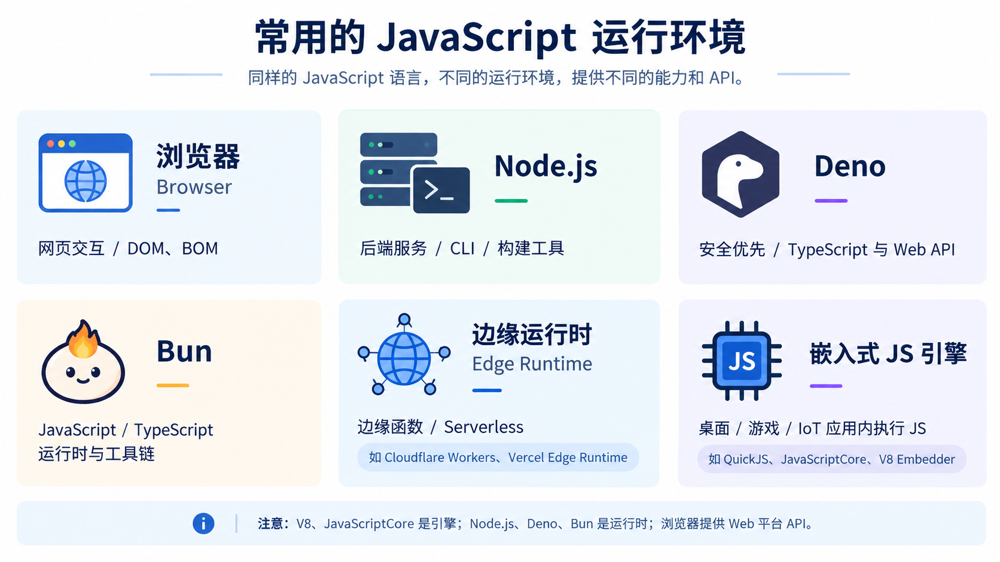

我们可以理解一下 JS 分层, 这里我们从 脚本语言规范\语言实现\运行时环境 来讲讲
- 脚本语言规范: ECMA-262 定义脚本语言该如何表现
- 语言实现/执行引擎: V8,SpiderMonkey,QuickJS,解析,编译,优化,执行, 这里这些都是为了 实现ECMAScript 规定的行为必须的步骤
- 运行时环境: NodeJS/Deno/Bun/浏览器 这些就是运行时的表现层

早期 JS 就是运用于浏览器动效的 而不是 作用于系统编程语言 到 2009 年 Ryan Dahl 发布 NodeJS 初版 这是 因为 V8 引擎发布开源 JS 性能开始有质的飞跃, 再者就是非阻塞I/O与事件驱动架构 因为 Web Application 需要频繁进行 I/O 操作(网络, 数据库, 文件等) 大量 I/O 操作 会阻塞处理流程 这回导致 资源利用率降低 NodeJS 将其事件循环和异步I/O能力整合到运行时中 让其适合处理 大量I/O 密集型操作 最后就是 NodeJS 还提供丰富的系统操作模块 比如 文件系统,网络,进程 等 让开发者可以真正应用于服务端开发的语言, 相对应的 还有些脚本语言 PHP,Python,Ruby 等这些动态脚本语言也在服务端用的开

NodeJS 就是基于事件驱动和非阻塞接口 且 主推就是 单线程 天然异步 API, 单线程意味着业务逻辑无需考虑 锁 问题, 异步 API 意味着可以方便处理并发问题 适合做服务端, 通过内置模块 框架就层出不穷 其中 `express.js`, `Koa.js`, `NestJS` 最为流行, 其中 `express/koa` 适合及其简单的项目, `NestJS` 适用于 企业级服务端的一个框架.

NodeJS 在多个领域都有用到 比如常用的 老牌打包工具, CLI, 简单脚本, Agent 应用开发(Codex/ClaudeCode 等等) 都选择 NodeJS 来实现, 其中还有 桌面端的 VsCode, 1Password, 钉钉 等桌面端软件 都是基于 ElectronJS

虽然新型打包工具有转向 `Go` 和 `Rust` 趋势但是依旧挡不住 `NodeJS` 当年的风采

## 模块规范
Node 中模块规范主要使用 CommonJS 和 ESM, CommonJS 使用最为广泛, ESM 为未来的趋势
1. 最早的模块化方式 IIFE(Immediately Invoked Function Expression) 立即函数调用表达式 定义时就会立即执行 JS 函数, 通过 函数作用域 将其变量与外部隔离开 形成一个模块
```js
(function() {
  // statements
})()
```

之后国内并发出现以下这些模块化解决方案

2. AMD(Asynchronous Module Definition)/CMD(Common Module Defineition)/UMD(Universal Module Definition)
这些模块规范首字母不同 后面两个单词缩写相同 AMD 为 异步模块定义, CMD 为 公共模块定义, UMD 为通用模块定义
AMD 和 CDM 可以说是非常类似, AMD 推崇 依赖前置提前执行, CDM 则是 依赖就加,延迟加载

3. CommonJS(CJS)
这里我们将 CommonJS 单独拉出来, 可见它的重要性, 它是 2009 年由 Mozila 工程师起草的, 而 AMD/CDM 也是在 2009/2010 年附近发展起来的, 包括前端体系也是 到 2010 年之后才迅速发展起来
CommonJS 最初为了除 浏览器之外的运行环境建立模块规范, 最初 CommonJS 叫做 ServerJS 后面才改为 CommonJS 因为想要推进所有运行环境标准化 而 CommonJS 也确实做到了 服务端JS应用,命令行工具,GUI,混合应用 等等你都可以看到 CommonJS 的影子

这里我给出上文所提到的所有模块方案的 mini 实现
- [amd](../../../code/nodejs/module_impl/amd.js)
- [cmd](../../../code/nodejs/module_impl/cmd.js)
- [umd](../../../code/nodejs/module_impl/umd.js)
- [commonjs](../../../code/nodejs/module_impl/commonjs.js)

4. ESM(ECMAScript Modules)
上面的这些模块规范都是 社区以及第三方规范, 并不是官方规范,而ESM就是 ECMAScript 官方模块机制, 该模块机制被内置到 JS 中无需引用外部模块实现机制,  它的设计非常简单 通过 `import/export/export default` 等关键字来进行导入导出, 只要宿主有实现那么该语法即可使用, 现代浏览器大多都支持该写法 包括 NodeJS 也在推荐官方的 ESM


5. Node 识别 CJS 和 ESM
通常 `*.mjs` 会被认为是 ESM, `*.cjs` 会被判定为 CJS, 若是普通的 `*.js` 则通过 `package.json` 的 `type` 字段来判断是哪一个模块类型的, 还有一个情况就是通过 `--eval` 参数启动 `node` 时 其中源码对应的 `--input-type` 参数是 commonjs 还是 esm 默认为 commonjs
在 CJS 模块规范下是无法使用 ESM 的, 但 ESM 模块规范可以间接实用 commonjs 的某些规范, 这里我们详细讲讲 在 ESM 中 `require/exports/module.exports` 是不存在的, 但是我们可以通过 import 来导入 CJS 文件 还可以通过 `node:module` 内置的模块来创建一个 require 函数 借此来导入 CJS 模块
```js
// cjs.cjs
const add = (a, b) => {
  return a + b
}

exports.add = add

module.exports = { add }

// esm.mjs
import { createRequire } from "node:module";
import mathCJS from './__test__/math1.cjs'

const require = createRequire(import.meta.filename)

const math = require('./__test__/math')
console.log(math.add(1, 2))
console.log(mathCJS.add(1, 2))
```
但是 CJS 可以通过 `import()` 动态导入来导入 ESM 模块
```js
import('./__test__/math2.mjs').then(math => {
  console.log(math.add(1, 2))
})
```
通过上面我们可以得到 ESM/CJS 的总结 它们在一定情况下可以互通
- CJS 无法实用 ESM 的模块语法, ESM 无法使用 CJS 的模块语法 但是 ESM 可以通过 `node:module` 内置模块来创建一个 导入 CJS 模块的导入器
- CJS 要加载 ESM 有一个办法就是 通过 动他 `import()`

### NodeJS CommonJS 模块本质解析


## Node 调试方法
调试 和 打印本质区别: 调试可以获取的信息量和打印获取的信息量是不同的, 调试可以看到代码的完整调用栈(既 执行路径)/用到的数据/作用域和作用域链 等信息 而 打印只能获取结果, 在你使用 框架时候 你想要看到框架执行路径那么 调试将是最好的选择. 当你熟悉调试会对代码运行流程越来越清晰相信你会 喜欢上 Debugger 的过程

### Node Chrome Debugger
我们就来简单的来走一下 通过 Chrome DevTools 来对 Node 进行 debugger 的流程

```js
// 1.js
const fs = require('node:fs');
const path = require('node:path');

const content = fs.readFileSync(path.join(path.resolve(__dirname), '..', 'eventEmitter/index.js'), { encoding: 'utf-8' })
```

运行下面的命令
```shell
node --inspect-brk 1.js
```

可以看到通过 webSocket 协议 来创建的 debugger 服务端 和 DevTools Client 连接的方式
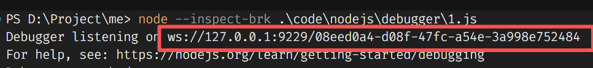

打开浏览器进入 `chrome://inspect` 中 添加 debugger 服务端地址
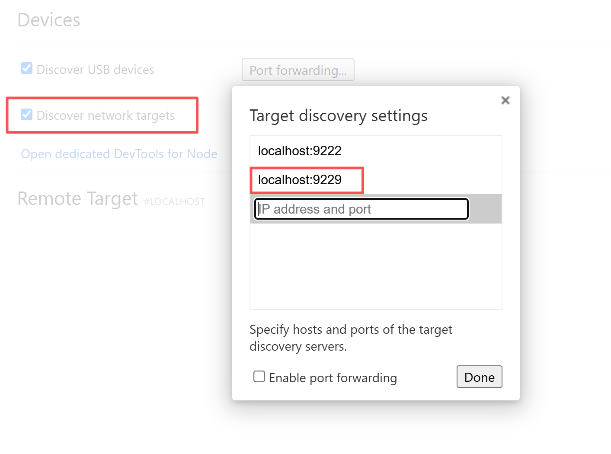

最后点击 inspect 就可以进入调试页面
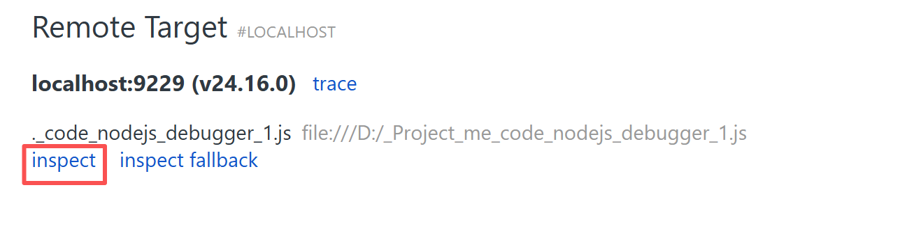

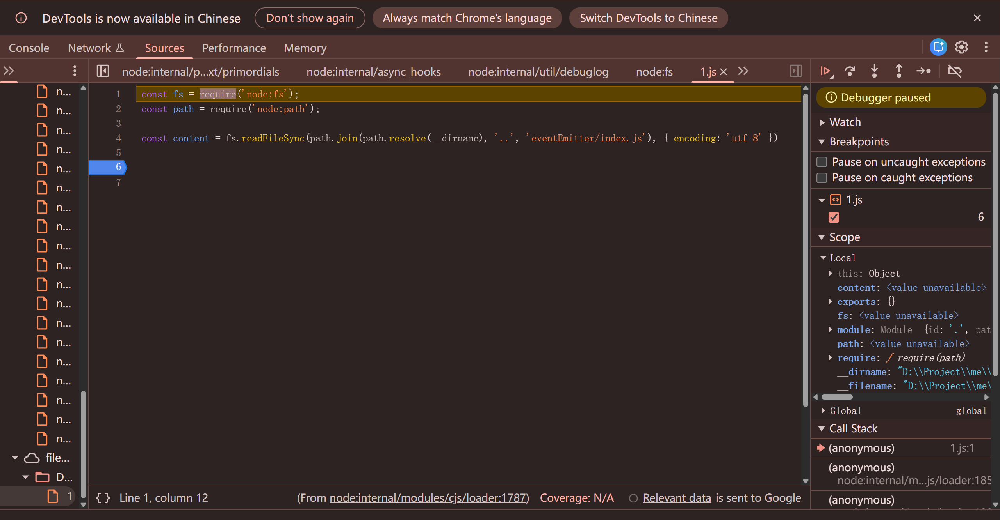


### Node VsCode Debugger
首先我们需要创建一个 `launch.json`
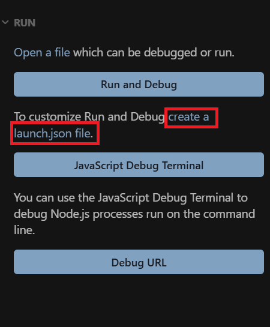

添加一个 node 类型的 attach
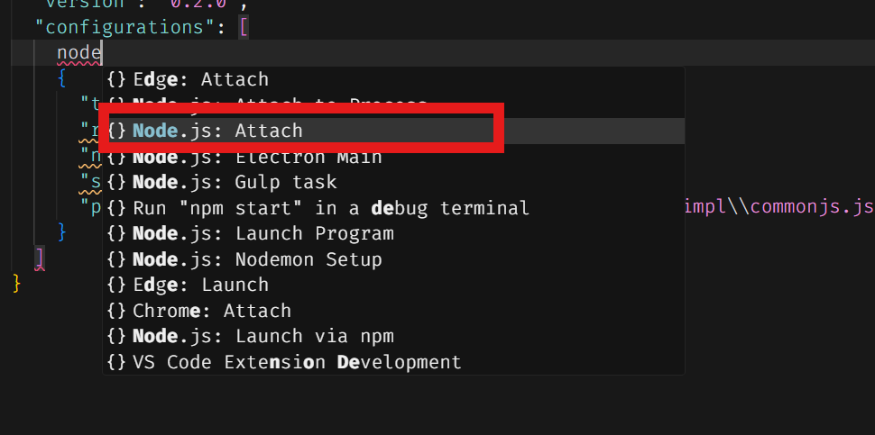

修改端口和 我们使用 `node inspect-brk` 相同的端口
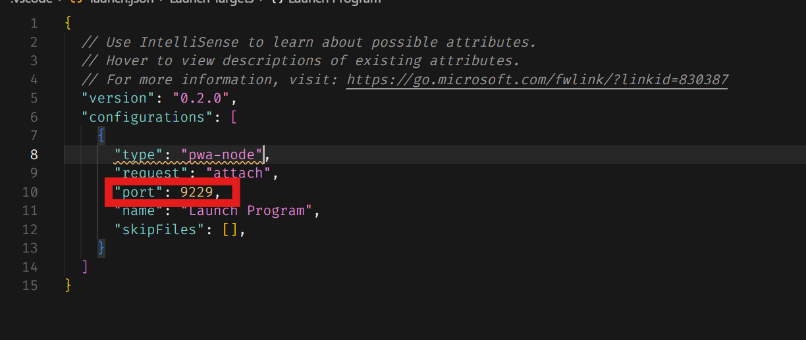

最后启动一下即可调试
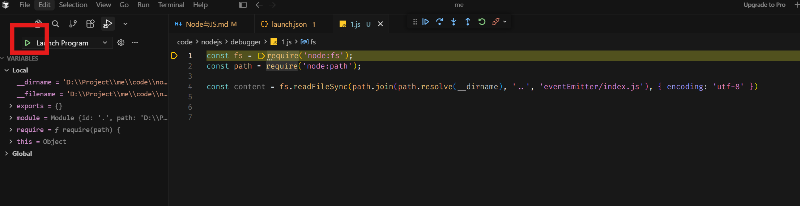

先通过 `node --inspect-brk` 来将服务跑起来 在创建 `attach.json` 步骤较为麻烦, 我们还有其他 `debugger` 方法, 通过在 `attach.json` 添加配置来自动化该流程
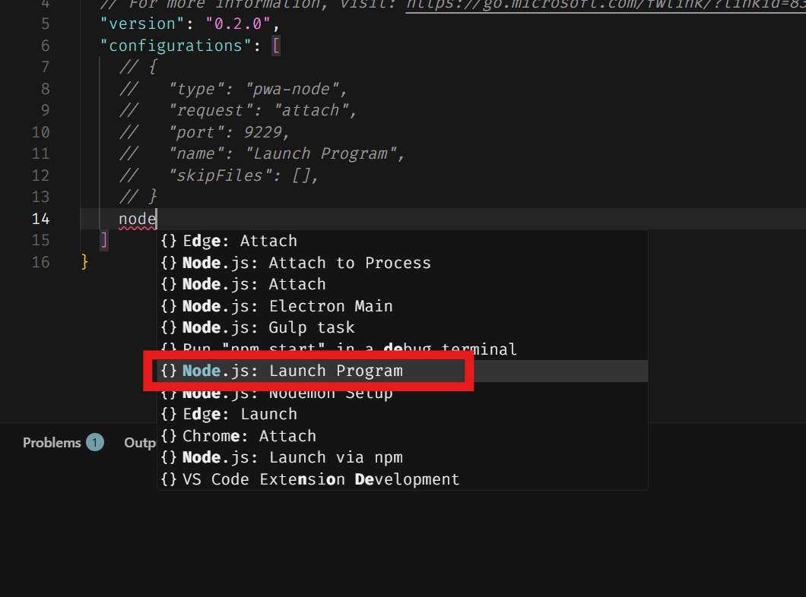

在这我们先在要添加断点的代码行点击一下, 最后运行即可
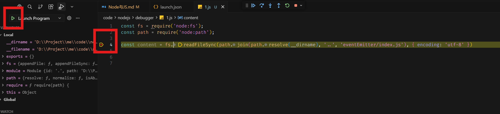
#### Node 其他调试方法
1. 字段讲解
- processId 连接 processId 调试
- program 调试的 node 代码
  - args
- runtimeExecutable 执行命令(从 PATH 中查找)
  - runtimeArgv
- skipFiles 跳过文件
- stopOnEntry 是否首行断住
- autoAttachChildProcesses (是否支持 child process)
- console 设置 输出 地点(内外部 terminal, debug console)
- cwd 设置工作目录
- env 设置 env 环境
- envFile 设置 env 文件
- presentation 对调试配置做分组或排序
```json
{
  // Use IntelliSense to learn about possible attributes.
  // Hover to view descriptions of existing attributes.
  // For more information, visit: https://go.microsoft.com/fwlink/?linkid=830387
  "version": "0.2.0",
  "configurations": [
    // Attach
    // 连接 ws 服务端
    {
      "name": "Attach",
      "port": 9229,
      "request": "attach",
      "skipFiles": [
        "<node_internals>/**"
      ],
      "type": "node"
    }

    // Attach by Process ID
    // 通过 进程 id 来连接服务端
    {
      "name": "Attach by Process ID",
      "processId": "${command:PickProcess}",
      "request": "attach",
      "skipFiles": [
        "<node_internals>/**"
      ],
      "type": "node"
    }

    // Launch Program 通过
    {
      "name": "Launch Program",
      "program": "${workspaceFolder}/code/nodejs/debugger/3.js",
      "request": "launch",
      "skipFiles": [
        "<node_internals>/**"
      ],
      // 运行命令的方式 (node | npm ...) 从 环境变量 PATH 中搜索
      "runtimeExecutable": "ts-node",
      // 添加参数
      "args": [
        "-a",
        "-b",
      ],
      "type": "node"
    },

    // pnpm 运行
    {
      "name": "Launch via pnpm",
      "request": "launch",
      "runtimeArgs": [
        "ts-node"
      ],
      "runtimeExecutable": "pnpm",
      // 跳过文件
      "skipFiles": [
        // 跳过 node 内部文件
        "<node_internals>/**"
      ],
      // 首行断住
      "stopOnEntry": true,
      "type": "node",
      // 打开系统 terminal 展示
      // "console": "externalTerminal",
      // 内置 terminal 打印
      // "console": "integratedTerminal",
      // 内置 debug console 面板
      // "console": "internalConsole",
      // 是否检测子进程
      // "autoAttachChildProcesses": true
      // 设置工作目录
      "cwd": "${workspaceFolder}",
      // 设置环境变量
      "env": {
        "a": "1",
        "b": "2"
      },
      // 设置环境变量 文件
      "envFile": "${workspaceFolder}/.env",
      // 分组排序设置(每个 配置都可以设置)
      "presentation": {
        "hidden": false,
        "group": "调试 node",
        "order": 1
      }
    },
  ]
}
```


### 调试原理
VsCodeDebugger 和 Chrome DevTools 它们只是一个对接 node 调试协议 的工具, 正因为有 **标准协议** 才会出现那么多的 调试工具, 标准化是世界趋势 不管在 任何行业 都是至关重要的的一环, 当然 标准化 在不同领域所以解决的问题不同. 但是它们都有一个目标就是 减少成本

NodeJS 是基于 V8 的, V8 本身就有调试协议 V8 Debug Protocol 所以早期 NodeJS 调试协议也是 V8 Debug Protocol, 早期调试是通过 `node debug <filepath>` 来打断点的, 通过 `run/cont/next/setp` 命令实现 调试, 这样调试是非常耗时费劲的, 所以 Node 就看向 ChromeDevTools 通过它来调试, 但是 Chrome DevToolsProtocol 和 V8 Debug Protocol 是不同的调试协议 它的解决方案就是通过 中间层 来进行 协议转换

所以你可以看到 npmjs.org 有一个包叫做 `node-inspector` 转换的, 后期NodeJS开发者觉得较为麻烦所以通过 提PR 将 V8 Inspector 即成到 NodeJS 中, 这个V8 Inspector 就是 Blink 内 Chrome DevTools Protocol 支持的部分(这部分是 V8 团队完成) 明显可以看出 上层服务依赖于下层建筑. 成熟后去除 `node debug` 后 `node-inspect` 就 推出历史舞台 改为 `node inspect` 启动 websocket 调试服务通过 `node --inspect | node --inspect-brk`

现在我们直到 其实就是 服务端和客户端相互连接, 基于调试协议完成不同功能 其他语言原理亦是如此

一个编辑器如何支持多种调试协议呢? 比如 VsCode, VsCode 并没有实现所有协议而是通过 **DPA(Debugger adpater Protocol) 调试适配协议** 来适配到各种调试协议上, 比如 Node 将调试协议改为 ChromeDevToolsProtocol 后实现一个 DAP 的 adapter 即可对接到VSCode 中, 这就是 **设计模式 适配器模式** 的魅力
