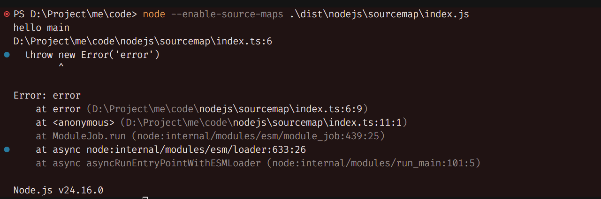

# sourcemap

## sourcemap 作用
sourcemap 的作用就将 转换后的代码和原始代码做映射关系, 让开发者在 开发/调试/性能分析 时可以看到原始代码位置
```txt
开发阶段源码 -> 编译/转义/压缩 -> 生产代码 -> sourcemap 建立映射 -> 调试工具还原代码
```

我们来测试一下 通过 sourcemap 来 调试 代码
```shell
pnpm add typescript @types/node -D

npx tsc --init
```
```json
// tsconfig.json
{
  "compilerOptions": {
    // 打包目录
    "outDir": "dist",
    "types": [ "node" ],
    "target": "es2016", 
    "module": "NodeNext", 
    "moduleResolution": "NodeNext",
    "esModuleInterop": true,
    "forceConsistentCasingInFileNames": true,
    // 严格见擦汗
    "strict": true,
    // 跳过库检查
    "skipLibCheck": true,
    // 开启 sourcemap
    "sourceMap": true
  }
}
```
```ts
// 正常代码
function main() {
  console.log('hello main')
}

// 测试运行后是否能将错误栈 映射到对应位置
function error() {
  throw new Error('error')
}

main()

error()
```

编译一下 可以看到dist下的 JS 文件都有一个对应的 sourcemap 文件
```shell
tsc -w
```

打开 VsCode Debugger 添加下面这个配置 并且在 原始 TS 代码中 打断点
```json
{
      "name": "Launch Program",
      // 对应自己的路径, 改成 index.ts 也可以
      "program": "${workspaceFolder}/nodejs/sourcemap/index.js",
      "request": "launch",
      "skipFiles": [
        "<node_internals>/**"
      ],
      "type": "node"
}
```

启动 Debugger 即可看到 我们会直接跳到源代码这里 Debugger

而 我们直接 通过 `node` 命令来解释 脚本 抛出的错误栈也是 `.ts` 源文件的
--enable-source-maps 只有在 >= node 12 版本下才有
在 < node 12 版本是通过 `source-map-support` 包来解决 NodeJS 运行时读取 SourceMap 并修改 ErrorStackTrace 让错误显示在 转换代码前的 源码位置
```shell
node --enable-source-maps ./dist/nodejs/sourcemap/index.jsS
```


## source-map-support
source-map-support 作用就是 让 NodeJS 运行时读取 sourcemap 并且 重写一下 `Error.prepareStackTrace` 方法

具体实现在 [source-map-support](../../../code/nodejs/source-map-support/index.ts)

1. 具体思路
  1. 重写 `Error.prepareStackTrace` 方法 主要就是 替换路径信息(其他方法都是为 重写路径信息而服务的)
  2. wrapCallSite 错误信息重构
  3. mapSourcePosition 映射编码位置
  4. retrieveSourceMapURL 读取 转换代码 的 `.js.map` 文件名称
  5. getSourceMapConsumer 读取 sourcemap 文件内容

总体核心代码非常简单, 很多代码都是 防御性编程, 你只需要了解核心即可, 主流程就是 修改错误信息 你就要 重构错误信息 你需要重构错误信息的代码位置 你就需要读取 sourcemap 文件路径 在读取内容 最后做替换

## sourcemap 实现

sourcemap 其实就是做一个映射关系, 映射编译前后的文件行列号, 最后将映射关系做编码
```js
// index.js.map
{"version":3,"file":"index.js","sourceRoot":"","sources":["../../../nodejs/sourcemap/index.ts"],"names":[],"mappings":"AAAA,SAAS,IAAI;IACX,OAAO,CAAC,GAAG,CAAC,YAAY,CAAC,CAAA;AAC3B,CAAC;AAED,SAAS,KAAK;IACZ,MAAM,IAAI,KAAK,CAAC,OAAO,CAAC,CAAA;AAC1B,CAAC;AAED,IAAI,EAAE,CAAA;AAEN,KAAK,EAAE,CAAA"}
```

